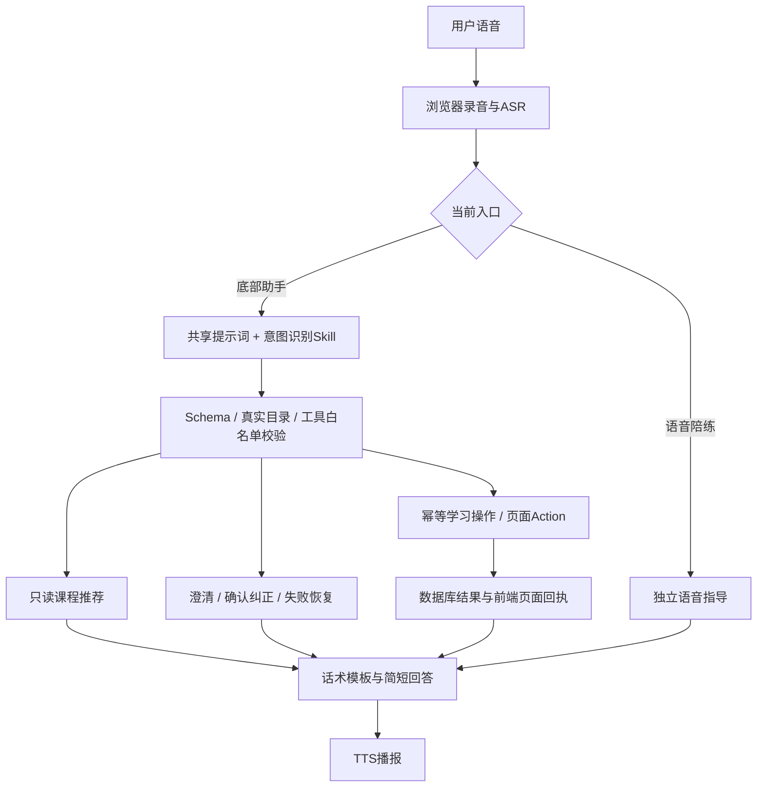

# 🎙️ 小伴 Senior AI Tutor v0.1.0

面向中老年兴趣学习的 AI 私教与应用助手 | An accessible learning companion with voice interaction and guided practice

## 📖 项目简介

小伴帮助用户通过语音发现兴趣、加入技能、打开课程，并在独立的陪练中获得提示。界面以大按钮、短文字和语音播报为主，支持手机端布局和电脑浏览器调试。

- 🏠 **首页与学习库**：今日推荐展示社区作品，正在学习的技能可直接进入教程。
- 📚 **技能广场**：家庭园艺、书法、摄影、节奏四类技能，各三节教程，保存学习进度与已完成技能。
- 🎙️ **小伴语音助手**：底部麦克风处理对话、加入技能、课程推荐、页面切换和播放器控制。
- 🎥 **独立陪练**：语音陪练在停顿后自动提交；视频陪练点击开始后采集抽样画面，支持可用的前后镜头切换。
- 🖼️ **社区与我的**：支持图片、视频上传，历史作品方块卡、全屏浏览及作品互动。
- 🧩 **五项 Agent Skill**：共享 System Prompt 配合意图识别、课程推荐、操作执行、话术生成和失败恢复。

当前交付为 React 网页前端与 FastAPI 后端，尚未生成 Android/iOS 安装包。课程为原创草稿和合成步骤示意，内置分享明确标记为虚构示例；支付未开放。

## 🚀 快速开始

### 方式一：Windows / VS Code 本地运行

准备 Python 3.12+、Node.js 22+、pnpm 11 和 uv。

#### Step 1：通过 SSH 克隆

```powershell
git clone git@github.com:AEI728/Senior-AI-Tutor.git
cd Senior-AI-Tutor
```

#### Step 2：安装依赖

```powershell
Push-Location apps/api
uv sync --frozen
Pop-Location

Push-Location apps/web
pnpm install --frozen-lockfile
Pop-Location
```

#### Step 3：创建环境变量文件

首次克隆时执行；已有 `.env` 的项目保留现有配置。

```powershell
Copy-Item .env.example .env
```

模板默认使用根目录 SQLite，无需先启动 Docker。没有模型密钥时使用模拟模式，可以查看页面与学习流程；真实语音和视觉需要配置相应服务。

在 `.env` 中配置实际服务，例如：

```dotenv
LLM_PROVIDER=deepseek
AUDIO_PROVIDER=deepseek
DEEPSEEK_API_KEY=your_api_key_here
DEEPSEEK_BASE_URL=https://api.deepseek.com
DEEPSEEK_MODEL=deepseek-flash
APP_PORT=4312
```

模型名称、地址和语音/图像能力必须与实际服务相符。修改配置后重启后端；真实调用失败会返回错误，不自动改用模拟回答。

#### Step 4：启动前后端

```powershell
.\apps\api\.venv\Scripts\python.exe scripts/tasks.py local
```

打开 [http://localhost:5173](http://localhost:5173)，保持终端运行。后端默认端口为 `4312`，接口文档位于 [http://localhost:4312/docs](http://localhost:4312/docs)。

在 VS Code 打开项目根目录后，也可以按 **Ctrl+Shift+P → 任务: 运行任务 → 小伴：启动前后端**。重复启动会复用已确认属于当前项目的服务。

macOS / Linux 使用相同的依赖安装流程，将启动命令中的 Python 路径换为 `./apps/api/.venv/bin/python`，复制配置使用 `cp .env.example .env`。

### 方式二：显式模拟模式

```powershell
.\apps\api\.venv\Scripts\python.exe scripts/tasks.py preview-local
```

此模式使用 SQLite 与 Mock，不调用真实模型，语音输入和视觉反馈不可作为真实能力体验。启动前先停止同端口的其他实例。

## 🔧 配置说明

### 环境变量

| 配置项 | 必填 | 默认值 / 模板值 | 说明 |
|---|---|---|---|
| `APP_ENV` | 否 | `local` | 本地开发环境 |
| `APP_PORT` / `PORT` | 否 | 模板 `4312` | 后端端口；前端本地启动代理会跟随 |
| `DATABASE_URL` | 否 | 根目录 SQLite | 不设置时使用 `local-preview.db`；可配置 PostgreSQL |
| `LLM_PROVIDER` | 否 | `auto` | 根据密钥选择 `deepseek`、`openai` 或 `mock` |
| `AUDIO_PROVIDER` | 否 | `auto` | 语音服务，与文本模型分别配置 |
| `DEEPSEEK_API_KEY` | DeepSeek 模式 | 空 | 只由后端读取 |
| `DEEPSEEK_BASE_URL` | 否 | `https://api.deepseek.com` | 实际兼容服务地址 |
| `DEEPSEEK_MODEL` | 否 | `deepseek-flash` | 必须是服务支持的模型 |
| `DEEPSEEK_TTS_VOICE` | 否 | `stella` | 当前语音接口的音色标识 |
| `OPENAI_API_KEY` | OpenAI 模式 | 空 | 可选提供商配置 |
| `KNOWLEDGE_BASE_PATH` | 否 | `data/knowledge` | 按课程目录读取本地参考资料 |
| `RAG_TOP_K` | 否 | `3` | 每次检索最多返回的片段数量 |
| `AUTH_MODE` | 否 | `dev` | 本地自动进入；另有待实际供应商验收的 OIDC 配置 |
| `MAX_RETRY_ATTEMPTS` | 否 | `2` | 同时受失败恢复 Skill 限制，实际最多安全重试一次 |

### 语音与设备调试

点击底部麦克风开始说话，再点击一次提交；语音陪练在停顿约 1.8 秒后自动提交，结束时点击“结束语音陪练”。两者使用独立会话与接口，回复只播报，不显示对话正文。

可以尝试：“打开技能广场”“把书法加入，再打开第一节课”“推荐一门摄影课程”“返回首页”。

电脑端使用 Chrome / Edge 的 `localhost` 页面并允许麦克风、摄像头权限；收音诊断位于 `/debug/audio`。录不到声音时检查实际输入设备和输入峰值；项目会尽量避开无信号的虚拟麦克风。VS Code 用于编辑和启动，收音由浏览器负责。

## 🧠 Agent 工作流程



视频陪练独立提交最多三张抽样帧。进入陪练页面只导航，设备等待用户点击开始。首页“今日推荐”读取社区作品，与用户主动请求的课程推荐分开。

### System Prompt 与 Skill

| 模块 | 文件 | 作用 |
|---|---|---|
| 共享提示词 | [`prompts/shared-system.md`](apps/api/app/prompts/shared-system.md) | 身份、表达、事实和权限原则 |
| 意图识别 | [`intent-recognition/SKILL.md`](apps/api/app/skills/intent-recognition/SKILL.md) | 输出受限结构化计划 |
| 课程推荐 | [`course-recommendation/SKILL.md`](apps/api/app/skills/course-recommendation/SKILL.md) | 真实候选筛选与规则排序 |
| 操作执行 | [`operation-execution/SKILL.md`](apps/api/app/skills/operation-execution/SKILL.md) | 白名单、对象校验与执行约束 |
| 话术生成 | [`response-generation/SKILL.md`](apps/api/app/skills/response-generation/SKILL.md) | 模板与适合播报的短句 |
| 失败恢复 | [`failure-recovery/SKILL.md`](apps/api/app/skills/failure-recovery/SKILL.md) | 有限重试、确认、撤销和手动入口 |

规则策略由后端代码执行；模型不能自行取得数据库或设备权限。实际调用会记录 Skill 版本与内容指纹。详见 [Skill 接入说明](docs/agent-skills.md)。

## 🔌 API 接口

| 接口 | 用途 |
|---|---|
| `GET /health/ready` | 数据库与当前提供商配置状态 |
| `POST /api/v1/dev/session` | 仅本地/测试环境的开发会话 |
| `GET /api/v1/catalog/skills` | 技能目录 |
| `GET /api/v1/catalog/skills/{id}/courses` | 技能下的多个教程 |
| `POST /api/v1/agent/turns` | 助手对话与学习操作计划 |
| `POST /api/v1/agent/ui-actions/{id}/ack` | 实际页面操作回执 |
| `GET /api/v1/agent/skills` | 已加载提示词和 Skill 版本 |
| `POST /api/v1/audio/transcriptions` | 语音识别 |
| `POST /api/v1/audio/speech` | 根据归属于当前用户的回复生成语音 |
| `POST /api/v1/voice/coach` | 独立语音陪练 |
| `POST /api/v1/camera/feedback` | 视频陪练抽样帧反馈 |
| `/api/v1/community/works` | 作品查询、投稿及媒体操作 |

除健康检查及认证入口外，业务接口需要当前用户身份。完整契约见 [OpenAPI 快照](docs/api/openapi.snapshot.json)。

PowerShell 本地调用示例：

```powershell
$api = 'http://localhost:4312'
$session = Invoke-RestMethod "$api/api/v1/dev/session" -Method Post
$headers = @{ Authorization = "Bearer $($session.access_token)" }
$body = @{
    agent_role = 'companion'
    client_request_id = [guid]::NewGuid().ToString()
    message = '打开技能广场'
    ui_context = @{ page = 'home' }
} | ConvertTo-Json -Depth 4
Invoke-RestMethod "$api/api/v1/agent/turns" -Method Post -Headers $headers -ContentType 'application/json; charset=utf-8' -Body ([Text.Encoding]::UTF8.GetBytes($body))
```

返回包含 `state`、`reply`、`ui_actions`、`completed_steps` 和 `skill_trace`。API 调用只生成导航计划，实际浏览器执行并回执后才确认页面已打开。

## 📚 课程与知识资料

| 目录 | 内容 |
|---|---|
| `data/courses/` | 四类技能、十二节原创课程草稿 |
| `data/knowledge/` | 按课程隔离的本地参考片段 |
| `data/community_examples.json` | 明确标记为示例的社区内容元数据 |
| `media/` | 教程与社区示例视频 |
| `apps/web/public/images/` | 技能配图及来源说明 |

当前检索为本地关键词匹配。课程推荐使用真实技能、学习状态及可用课程字段；缺少时长或难度标注时，不编造满足条件的推荐理由。

## 📁 项目结构

```text
Senior-AI-Tutor/
├── apps/
│   ├── web/                       # React / TypeScript / Vite 前端
│   │   ├── src/app/               # 全局布局、路由与设置
│   │   ├── src/pages/             # 首页、技能、教程、推荐和陪练
│   │   ├── src/features/          # 助手、社区、学习和音频功能
│   │   ├── src/styles/            # 页面样式与手机适配
│   │   └── e2e/                  # 浏览器测试及合成语音输入
│   └── api/                       # FastAPI / SQLAlchemy 后端
│       ├── app/prompts/           # 共享提示词与角色约束
│       ├── app/skills/            # 五项 Skill 及配套策略
│       ├── app/skill_runtime.py   # Skill 加载和规则运行
│       ├── alembic/               # 数据库升级迁移
│       └── tests/                 # 后端测试
├── data/                          # 课程、知识资料和示例元数据
├── media/                         # 内置媒体素材
├── scripts/                       # 启动、检查、备份与打包
├── evals/                         # 意图评测案例
├── docs/                          # 架构、Skill、契约和验证说明
├── .vscode/tasks.json             # VS Code 启动任务
├── .env.example                   # 无真实密钥的配置模板
└── README.md
```

逐文件说明及“改功能该找哪里”见 [代码结构说明](代码结构说明.md)。

## 🧪 检查与维护

在项目根目录执行：

```powershell
.\apps\api\.venv\Scripts\python.exe scripts/tasks.py lint
.\apps\api\.venv\Scripts\python.exe scripts/tasks.py typecheck
.\apps\api\.venv\Scripts\python.exe scripts/tasks.py test-unit
.\apps\api\.venv\Scripts\python.exe scripts/tasks.py test-sqlite
.\apps\api\.venv\Scripts\python.exe scripts/tasks.py test-web
.\apps\api\.venv\Scripts\python.exe scripts/tasks.py contract
.\apps\api\.venv\Scripts\python.exe scripts/tasks.py build
.\apps\api\.venv\Scripts\python.exe scripts/tasks.py e2e
```

首次运行浏览器测试前，在 `apps/web` 执行 `pnpm exec playwright install chromium`。普通 E2E 使用独立的 `8000/5174` 模拟服务和测试数据库；测试输出统一保存到 `artifacts/`。

2026-11-19 已通过 70 项后端测试、6 项前端单元测试、22 项浏览器测试，以及契约、静态检查和构建。真实 DeepSeek 的导航计划、组合操作、推荐、纠正、闲聊、独立语音陪练和 TTS 已显式验证，记录见 [当前验证说明](docs/verification.md)。

真实 API 验收只在显式执行下列命令时调用提供商：

```powershell
.\apps\api\.venv\Scripts\python.exe scripts/agent_skills_smoke.py --live
```

常用维护：

- `python scripts/check_agent_skills.py`：校验 Skill 包、白名单与 Plan 契约。
- `python scripts/backup.py`：备份业务数据库。
- `python scripts/check_public_source.py --staged`：检查 Git 待提交内容中的密钥与私人运行文件。
- `python scripts/package_source.py`：生成脱敏源码包至 `artifacts/packages/`。

上述 Python 命令使用项目后端虚拟环境。修改 `.env` 或 Skill 后重启服务。数据库迁移文件、依赖锁文件及合成语音测试输入需要随源码保留。

## ⚠️ 已知限制

| 限制 | 当前状态 |
|---|---|
| 手机安装包 | 当前为网页工程；浏览器访问手机端摄像头/麦克风需要安全上下文 |
| 语音模式 | 录音、识别与播报分阶段处理；并非全双工实时通话 |
| 提供商能力 | 语音、TTS和图像反馈需要相应接口，只有文本接口不足以提供全部能力 |
| 视频陪练 | 基于抽样帧提供提示，不是连续视频理解或动作达标认证 |
| 任务计划 | 支持单项和“加入后开课”组合，尚无任意多步骤依赖图 |
| 内容质量 | 课程和视频为演示草稿，尚未经过专业教学审核 |
| 正式部署 | OIDC、PostgreSQL、TLS和容器模板已保留，需结合实际环境另行验收 |
| 支付 | 未实现 |

## 🔐 数据与隐私

- `.env` 仅保留在本机，密钥不进入前端、Git 或源码包。
- `local-preview.db` 保存学习记录、作品及上传媒体；`backups/` 保存私人备份，均排除上传。
- 原始录音和摄像头帧不长期保存；开启真实服务时，必要的语音、文本或图像会发送给所配置的提供商。
- 公开作品、删除学习数据及设备权限走明确确认流程；作品保留审核与举报机制。
- 当前本地开发身份自动进入首页，公开部署应配置实际认证与 HTTPS。

## 📄 License

目前尚未指定开源许可证，公开源码不等于授予任意再分发或商用许可。

## 🙏 致谢

React、Vite、FastAPI、SQLAlchemy、Lucide，以及项目中配置的模型与语音服务。
