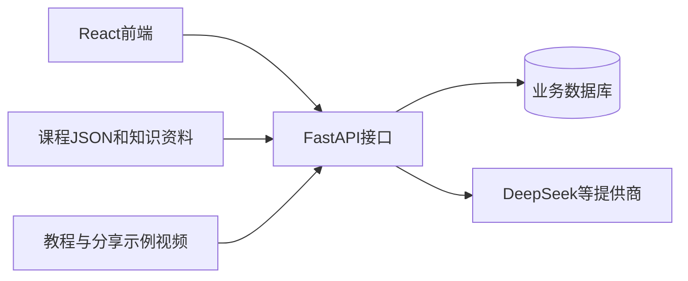

# 当前代码架构

前端采用 React / TypeScript，后端采用 FastAPI / SQLAlchemy，默认使用 SQLite 保存本地业务数据。

## 运行结构

浏览器加载React/Vite前端，经同源`/api`代理访问FastAPI。根目录.env仅由后端和本地启动脚本读取，浏览器不持有提供商密钥。本地业务保存在SQLite，部署配置可使用PostgreSQL。

## 语音角色

- 助手：底部麦克风→PCM/WAV→ASR→`/agent/turns`→受限工具与数据库操作→导航ACK→TTS。历史、角色和工具执行与陪练分开。
- 语音陪练：陪练页独立录音→ASR→`/voice/coach`→指导回答→TTS；停顿后自动提交，不发起助手导航操作。
- 视频陪练：点击开始后开启摄像头→最多三帧→`/camera/feedback`→播报。前后镜头切换会先释放旧轨道；抽样画面不构成完整动作核验。

录音与播放按角色归属管理，切换入口时释放上一种采集并取消迟到回复。电脑端避开没有有效输入的虚拟麦克风；手机保持默认语音输入。原始录音和摄像头帧不长期保存。

## 学习与作品

课程源文件在data/courses，初始化后保存在Course表；seed不覆盖已有课程和进度。学习中与已完成分别保存。社区投稿、图片和视频内容保存在业务数据库中；平台内置示例由data/community_examples.json与media/shares提供，并明确标记为示例。

作品的媒体、缩略图、互动和审核都复用用户权限校验。个人数据删除会清理该用户的学习、会话、作品及相关互动，身份记录保留以避免令牌重分配。

## 数据库版本

alembic/versions中的0001至0005构成升级链：初始学习与会话、账号与作品、作品图片、视频互动、已完成技能。必须保留整条迁移链，新功能通过新增迁移升级，不能重写旧迁移代替升级。

## 产物和依赖

artifacts保存构建与测试产物；backups保存本地备份，均不提交Git。前端dist、node_modules和后端.venv由构建或安装生成。本地启动方式见根目录README。
